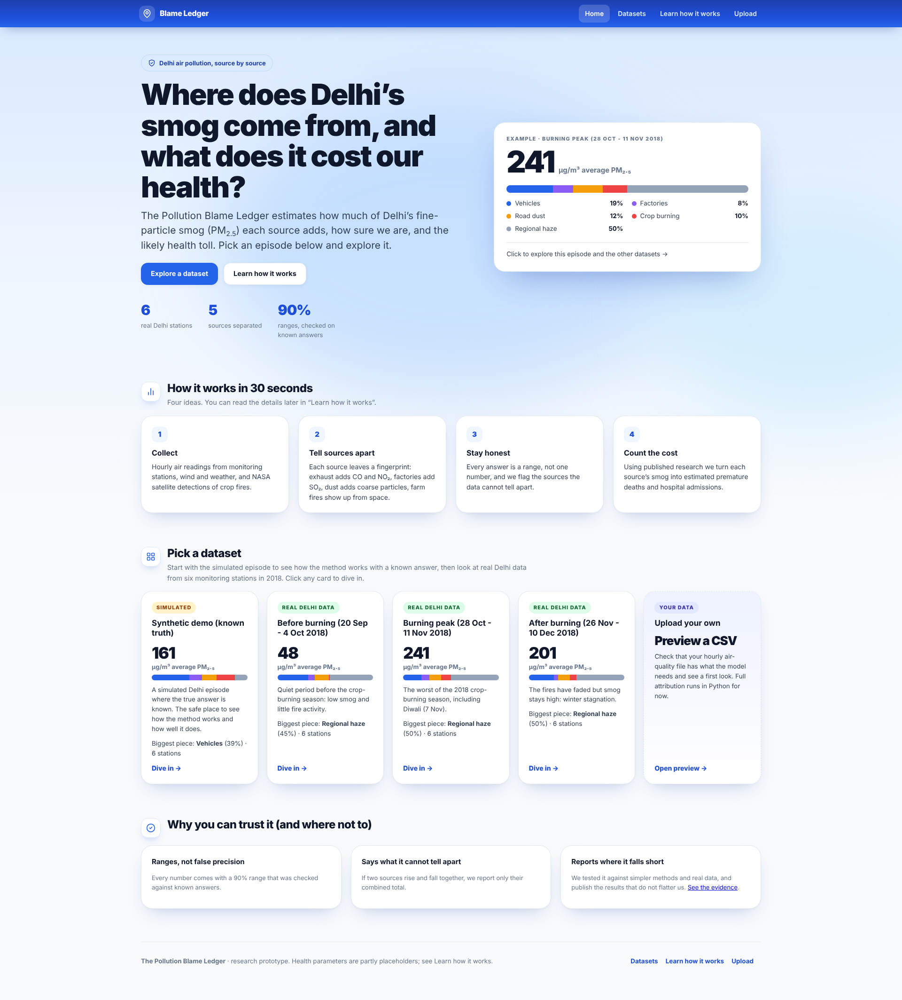
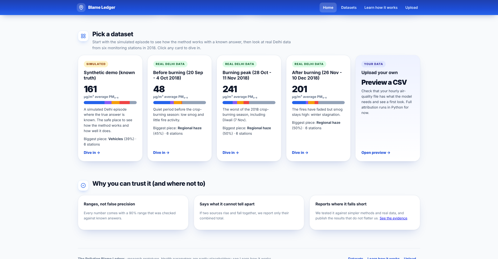
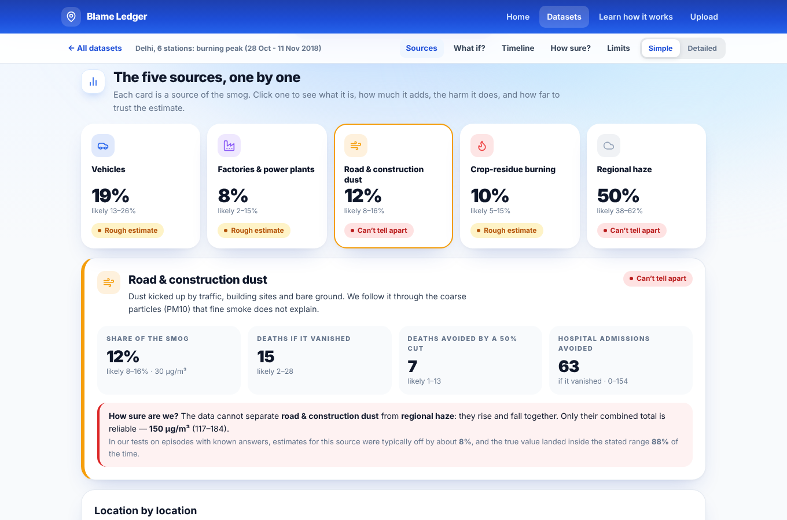
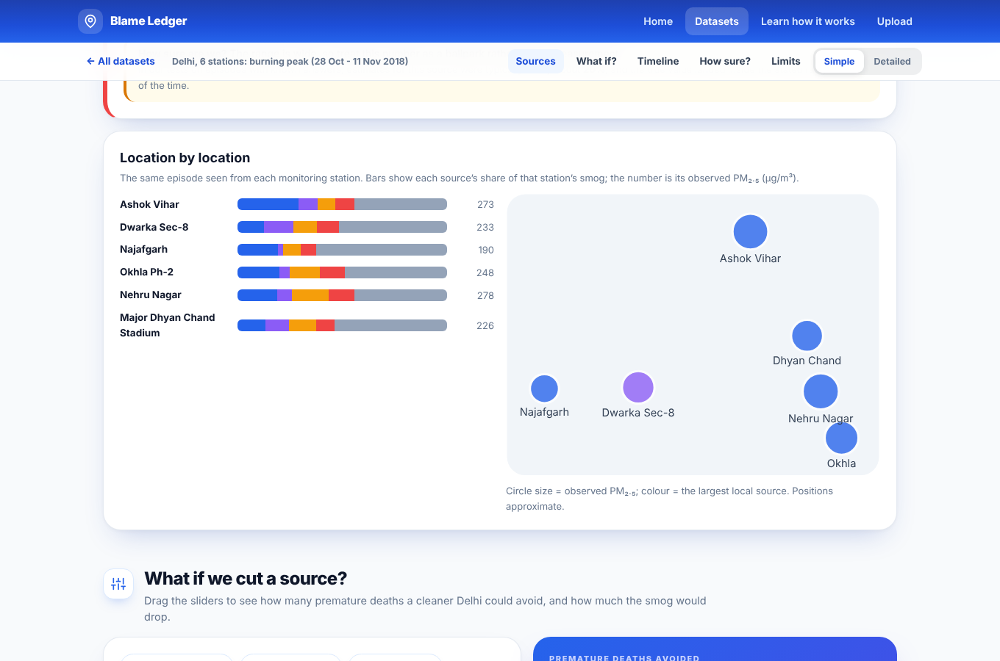
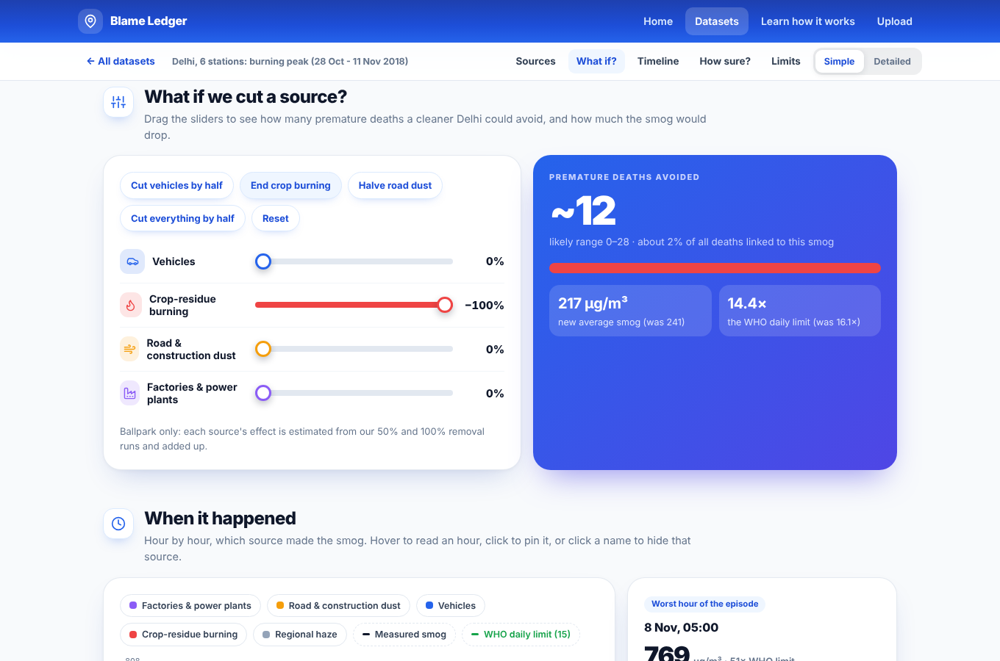
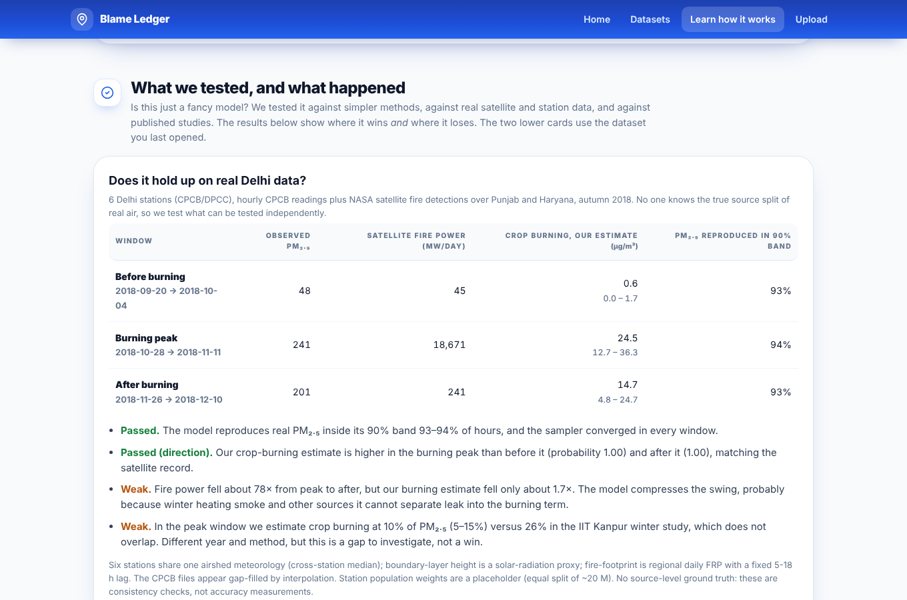
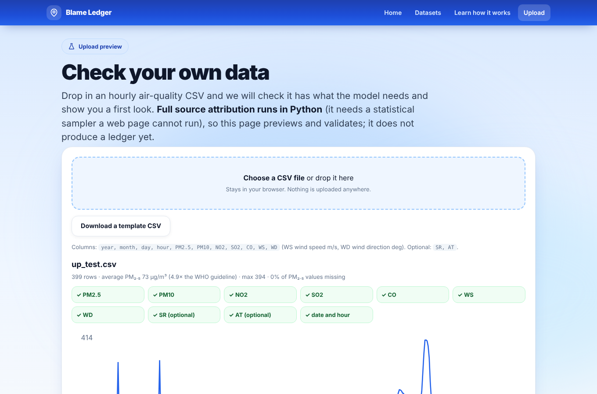
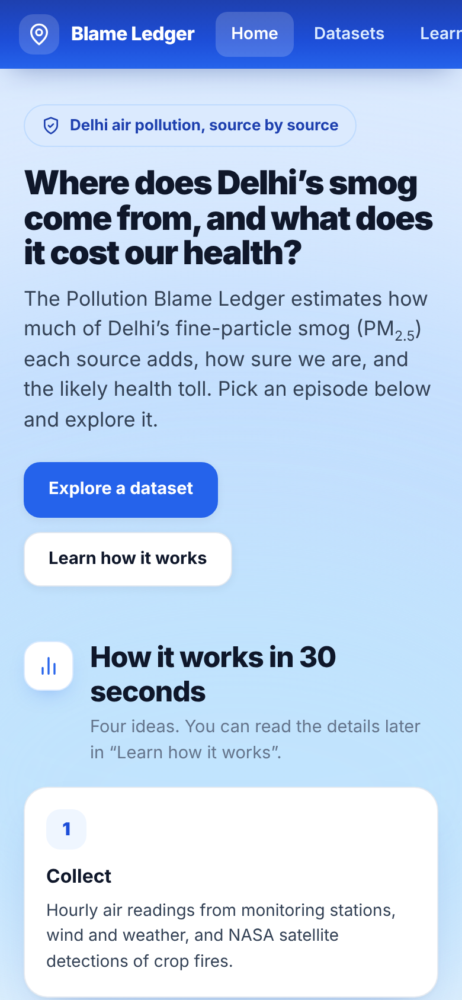
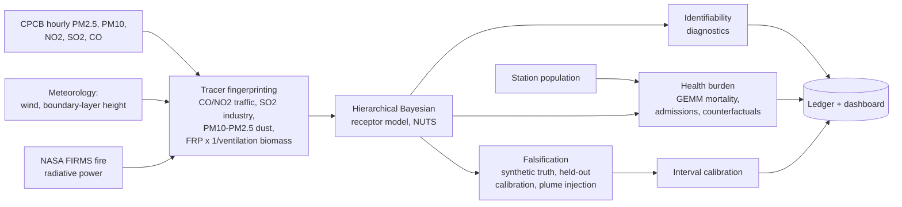

<div align="center">

# The Pollution Blame Ledger

**Probabilistic source apportionment of Delhi PM<sub>2.5</sub>, with uncertainty-quantified health burden and an explicit statement of what the data cannot separate.**


</div>

> **Research prototype. Read before citing any number.** All data in this repository is **synthetic** (simulated Delhi-like observations with known ground truth). GEMM parameters are verified against the published release; baseline mortality, population and admissions values are still **placeholders**. Source splits are only reliable after the validation-derived interval widening described below. Nothing here is a claim about real Delhi air or real deaths.

<p align="center">
  
</p>

## Contents
[Research foundation](docs/RESEARCH.md) · [The problem](#the-problem) · [What the ledger does differently](#what-the-ledger-does-differently) · [Dashboard tour](#dashboard-tour) · [How it works](#how-it-works) · [Results](#results) · [Quick start](#quick-start) · [Using real data](#using-real-data) · [Repository layout](#repository-layout) · [Limitations and roadmap](#limitations-and-roadmap)

## The problem
Delhi's PM<sub>2.5</sub> episodes are the superposition of co-varying emission streams (crop-residue burning, vehicles, construction dust, industry) modulated by meteorology. Attribution is an ill-posed inverse problem, so public debate runs on anecdote that cannot be falsified, and the health burden of each source is never quantified.

## What the ledger does differently
| | Typical dashboards | The Pollution Blame Ledger |
|---|---|---|
| Output | µg/m³ readings | Share, premature deaths and hospital admissions **per source** |
| Uncertainty | Rarely shown | 90% credible intervals on every figure, calibrated on held-out tests |
| Limits | Implicit | **Identifiability is a first-class output**: source pairs the data cannot separate are flagged and reported as a sum |
| Trust | Take our word | **Falsifiable**: synthetic plume injection and held-out episodes with known truth |
| Policy use | Descriptive | Counterfactual source removal (50% and 100% cuts) |

## Dashboard tour
One self-contained HTML file with four places, reachable from the top bar. A first-time visitor can follow them in order.

<table>
<tr>
<td width="50%"><b>1. Home: what is this?</b><br>A plain-language intro and four steps, then the datasets.<br></td>
<td width="50%"><b>2. Datasets</b><br>The simulated episode (known truth), three real Delhi windows from six CPCB stations, and an upload card.<br></td>
</tr>
<tr>
<td width="50%"><b>3. Dive in</b><br>Click a source for its share, deaths, and a plain-words trust label with test accuracy.<br></td>
<td width="50%"><b>4. Station by station</b><br>A map and per-station split for multi-station datasets.<br></td>
</tr>
<tr>
<td width="50%"><b>5. What if we cut it?</b><br>Sliders and presets: deaths avoided and the new smog level.<br></td>
<td width="50%"><b>6. Learn how it works</b><br>A five-step story, each with a "Go deeper" panel.<br></td>
</tr>
<tr>
<td width="50%"><b>7. The research, with wins and losses</b><br>Baselines, shifted-event stress test, literature check, real-data checks, parameter provenance.<br></td>
<td width="50%"><b>8. Upload preview</b><br>Check your own hourly CSV in the browser. Full attribution still runs in Python.<br></td>
</tr>
</table>

A **Simple / Detailed** switch inside each dataset hides the technical tables. The page is responsive down to phone width.

<p align="center"></p>

## How it works


| Step | Code |
|---|---|
| 1. Multi-modal data fusion | `ledger/ingest.py`, `ledger/features.py` |
| 2. Tracer fingerprinting | `ledger/features.py` |
| 3. Hierarchical Bayesian receptor model | `ledger/model.py` (non-negative partially pooled source terms, learned tracer baselines, tracer cross-talk unmixing, proxy-mismatch gain, daily background random walk); `ledger/diagnostics.py` |
| 4. Health-burden propagation | `ledger/health.py` (GEMM mortality, short-term admissions, Monte Carlo over CRF and baseline-rate uncertainty) |
| 5. Falsification and generalisation | `ledger/validate.py`, `ledger/calibration.py` |

## Results
First validation on synthetic episodes (12 calibration episodes, 8 held-out):

| Component | Median relative error | 90% interval coverage (raw) | 90% interval coverage (calibrated, held-out) |
|---|---|---|---|
| Road and construction dust | 8% | 63% | 88% |
| Traffic + crop burning (sum) | 8% | 38% | 100% |
| Traffic | 41% | 0% | 100% |
| Crop-residue burning | 20% | 25% | 100% |
| Industry | 55% | 0% | 100% |
| Regional background | 27% | 0% | 75% |

- **Baselines (honest result).** On 8 events with a deliberately shifted source mix, our calibrated ranges contained the truth 80% of the time vs 23% for non-negative least squares; a fixed published split gives no range. Our model is *not* the most accurate point estimate on every source (best on 1 of 5; the fixed split wins when the event resembles the report). Its contribution is calibrated uncertainty and the unresolved-background estimate. See [docs/RESEARCH.md](docs/RESEARCH.md).
- Total PM<sub>2.5</sub> is reproduced inside its 90% predictive band 93% of the time.
- Doubling a source's emissions (plume injection) is detected for both traffic and biomass; for biomass the true value still falls outside the calibrated interval.
- Raw posterior intervals are over-confident. Calibration widens them (x2 to x5) so coverage holds on unseen episodes. This makes the ledger honest, not more precise.
- Traffic and crop burning cannot be separated reliably, so only their sum is reported as reliable.

## Quick start
```bash
pip install -r requirements.txt
python run.py --demo                    # ~10 min: 12 calibration + 8 held-out episodes, plume injection, dashboard
python run.py --demo --skip-validation  # ~30 s: reuse the saved calibration and validation
python run.py --real                    # ~4 min: six real Delhi stations + NASA FIRMS (3 windows); adds them to the dashboard
python -m pytest tests                  # offline tests
```
Open `outputs/dashboard.html`. It is a single file: start on the Home page and pick a dataset card (synthetic demo or real Delhi windows). The Upload page previews your own CSV in the browser; full attribution of uploads is a later feature.

## Using real data
```bash
python -m ledger.ingest --cpcb data/cpcb/ --firms data/firms_viirs.csv --stations data/stations.csv \
    --start 2025-11-01 --end 2025-11-10 --out data/episode
python run.py --csv data/episode/observations.csv --stations data/episode/stations.csv
```
`stations.csv` needs `station, lat, lon, pop_m`, with station names matching the CPCB files. The ingestion module is unit-tested on fabricated fixtures only. The Open-Meteo fetch and real CPCB/FIRMS exports have **not** been run end to end, so expect to adjust column matching on first contact with real files.

## Repository layout
```
run.py                  entry point (demo or real data)
ledger/
  synth.py              synthetic Delhi episodes with known ground truth
  ingest.py             CPCB / Open-Meteo / FIRMS -> model schema
  features.py           tracer fingerprinting
  model.py              hierarchical Bayesian receptor model (NumPyro)
  diagnostics.py        identifiability flags
  health.py             mortality and admissions burden (GEMM verified, ex-China sensitivity)
  baselines.py          NNLS and fixed-published-split baselines, shifted-event stress test
  literature.py         published Delhi apportionment ranges and overlap check
  realdata.py           real CPCB hourly (6 stations) + NASA FIRMS -> model schema
  realcheck.py          out-of-model checks on real data
  synth_alt.py          independent misspecified generator (scoring run pending)
data/cpcb/              six real hourly station files (Jun 2018 - Oct 2019)
data/                   NASA FIRMS daily fire power (Punjab/Haryana, 2018)
  validate.py           held-out validation and plume injection
  calibration.py        interval calibration
  pipeline.py           end-to-end orchestration
dashboard/template.html dashboard source
outputs/                generated results and dashboard
docs/screenshots/       images used in this README
tests/                  offline tests
```

## Limitations and roadmap
1. **Real data: six stations, one season.** The pipeline runs on six real Delhi stations with NASA fires (`python run.py --real`); it reproduces PM2.5 and gets the burning direction right but compresses the burning swing (see docs/RESEARCH.md). Multi-station data and independent ground truth (speciation campaigns) are still needed.
2. **Partly placeholder health parameters.** GEMM parameters are now verified against the authors' release (see [docs/RESEARCH.md](docs/RESEARCH.md)); Delhi baseline rate, population and the admissions function are still placeholders.
3. **Source separation.** Add explicit source profiles (PMF/CMB-style) and Lagrangian back-trajectories to separate traffic from crop burning.
4. **Unused inputs.** Sentinel-2 land-cover change and OpenStreetMap road and industrial geometries are not yet used.
5. **Real-time view.** A hosted live panel with current station readings.
6. **Real-data validation.** Leave-one-episode-out on real episodes and triangulation against published apportionment studies.

## License
MIT. See `LICENSE`.
