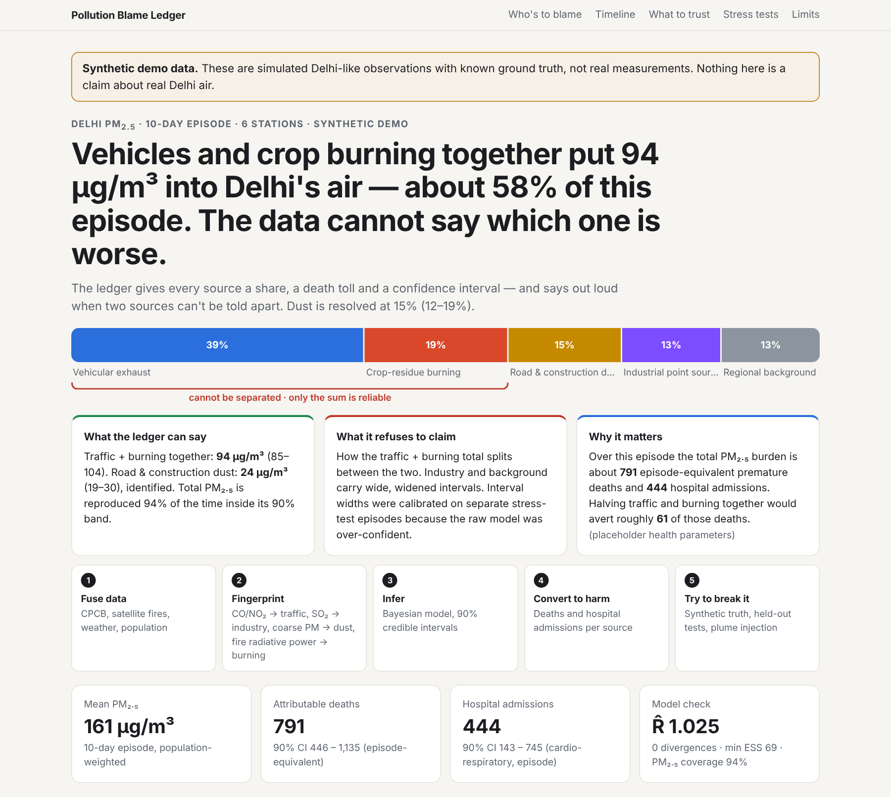
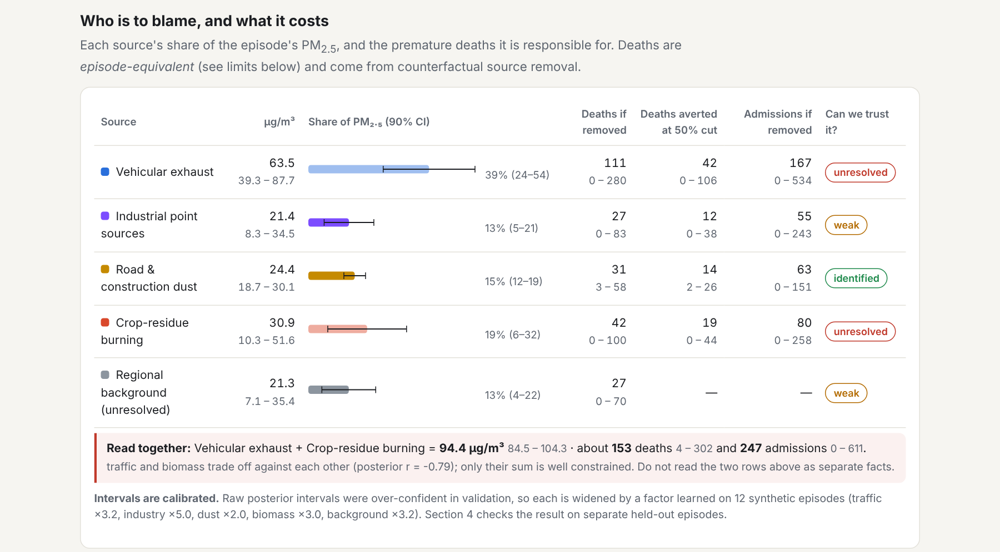
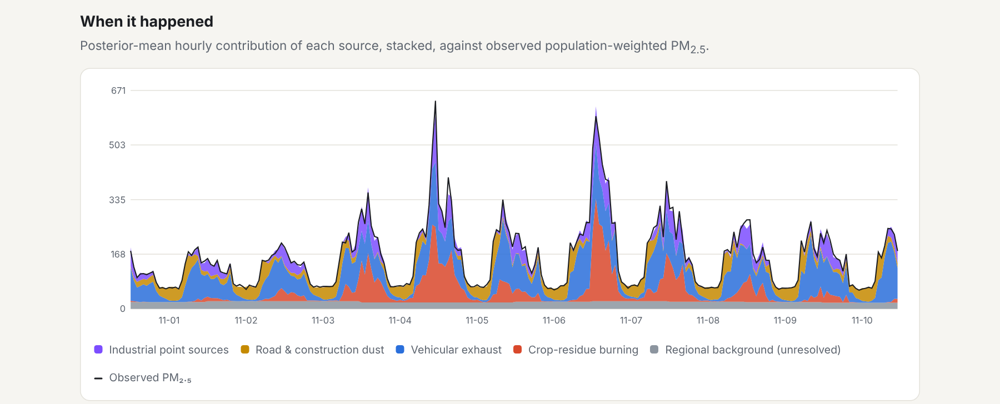
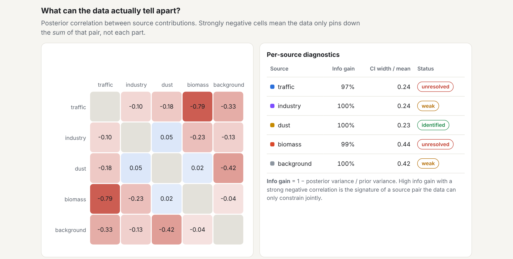
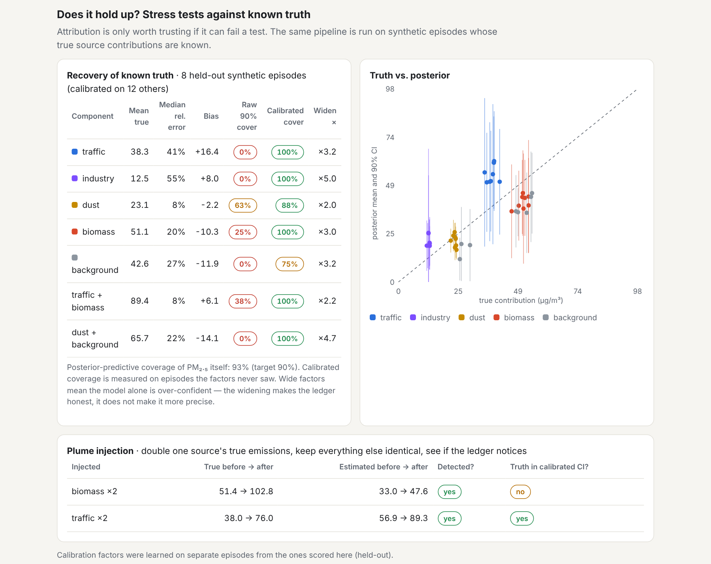
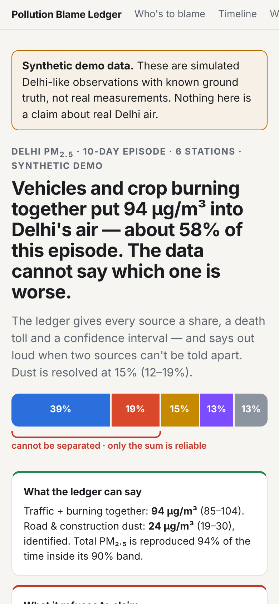
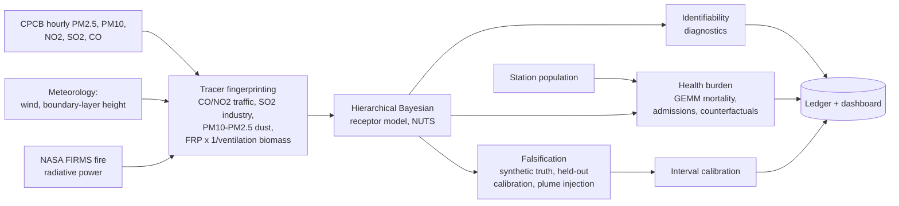

<div align="center">

# The Pollution Blame Ledger

**Probabilistic source apportionment of Delhi PM<sub>2.5</sub>, with uncertainty-quantified health burden and an explicit statement of what the data cannot separate.**


</div>

> **Research prototype. Read before citing any number.** All data in this repository is **synthetic** (simulated Delhi-like observations with known ground truth). Health figures use **placeholder** concentration-response, baseline-mortality and population values. Source splits are only reliable after the validation-derived interval widening described below. Nothing here is a claim about real Delhi air or real deaths.

<p align="center">
  
</p>

## Contents
[The problem](#the-problem) · [What the ledger does differently](#what-the-ledger-does-differently) · [Dashboard tour](#dashboard-tour) · [How it works](#how-it-works) · [Results](#results) · [Quick start](#quick-start) · [Using real data](#using-real-data) · [Repository layout](#repository-layout) · [Limitations and roadmap](#limitations-and-roadmap)

## The problem
Delhi's PM<sub>2.5</sub> episodes are the superposition of co-varying emission streams (crop-residue burning, vehicles, construction dust, industry) modulated by meteorology. Attribution is an ill-posed inverse problem, so public debate runs on anecdote that cannot be falsified, and the health burden of each source is never quantified.

## What the ledger does differently
| | Typical dashboards | The Pollution Blame Ledger |
|---|---|---|
| Output | µg/m³ readings | Share, premature deaths and hospital admissions **per source** |
| Uncertainty | Rarely shown | 90% credible intervals on every figure, calibrated on held-out tests |
| Limits | Implicit | **Identifiability is a first-class output**: source pairs the data cannot separate are flagged and reported as a sum |
| Trust | Take our word | **Falsifiable**: synthetic plume injection and held-out episodes with known truth |
| Policy use | Descriptive | Counterfactual source removal (50% and 100% cuts) |

## Dashboard tour
<table>
<tr>
<td width="50%"><b>1. The ledger</b><br>Per-source share, deaths and admissions, each with an interval and a "can we trust it?" label.<br></td>
<td width="50%"><b>2. Timeline</b><br>Hourly posterior-mean contribution of each source against observed PM<sub>2.5</sub>.<br></td>
</tr>
<tr>
<td width="50%"><b>3. What can the data tell apart?</b><br>Posterior correlations expose trade-offs (traffic vs. crop burning, r = -0.79).<br></td>
<td width="50%"><b>4. Stress tests</b><br>Recovery of known truth, calibration before and after widening, plume injection.<br></td>
</tr>
</table>

The dashboard is a single self-contained HTML file and is responsive down to phone width.

<p align="center"></p>

## How it works


| Step | Code |
|---|---|
| 1. Multi-modal data fusion | `ledger/ingest.py`, `ledger/features.py` |
| 2. Tracer fingerprinting | `ledger/features.py` |
| 3. Hierarchical Bayesian receptor model | `ledger/model.py` (non-negative partially pooled source terms, learned tracer baselines, tracer cross-talk unmixing, proxy-mismatch gain, daily background random walk); `ledger/diagnostics.py` |
| 4. Health-burden propagation | `ledger/health.py` (GEMM mortality, short-term admissions, Monte Carlo over CRF and baseline-rate uncertainty) |
| 5. Falsification and generalisation | `ledger/validate.py`, `ledger/calibration.py` |

## Results
First validation on synthetic episodes (12 calibration episodes, 8 held-out):

| Component | Median relative error | 90% interval coverage (raw) | 90% interval coverage (calibrated, held-out) |
|---|---|---|---|
| Road and construction dust | 8% | 63% | 88% |
| Traffic + crop burning (sum) | 8% | 38% | 100% |
| Traffic | 41% | 0% | 100% |
| Crop-residue burning | 20% | 25% | 100% |
| Industry | 55% | 0% | 100% |
| Regional background | 27% | 0% | 75% |

- Total PM<sub>2.5</sub> is reproduced inside its 90% predictive band 93% of the time.
- Doubling a source's emissions (plume injection) is detected for both traffic and biomass; for biomass the true value still falls outside the calibrated interval.
- Raw posterior intervals are over-confident. Calibration widens them (x2 to x5) so coverage holds on unseen episodes. This makes the ledger honest, not more precise.
- Traffic and crop burning cannot be separated reliably, so only their sum is reported as reliable.

## Quick start
```bash
pip install -r requirements.txt
python run.py --demo                    # ~10 min: 12 calibration + 8 held-out episodes, plume injection, dashboard
python run.py --demo --skip-validation  # ~30 s: reuse the saved calibration and validation
python -m pytest tests                  # offline tests
```
Open `outputs/dashboard.html`.

## Using real data
```bash
python -m ledger.ingest --cpcb data/cpcb/ --firms data/firms_viirs.csv --stations data/stations.csv \
    --start 2025-11-01 --end 2025-11-10 --out data/episode
python run.py --csv data/episode/observations.csv --stations data/episode/stations.csv
```
`stations.csv` needs `station, lat, lon, pop_m`, with station names matching the CPCB files. The ingestion module is unit-tested on fabricated fixtures only. The Open-Meteo fetch and real CPCB/FIRMS exports have **not** been run end to end, so expect to adjust column matching on first contact with real files.

## Repository layout
```
run.py                  entry point (demo or real data)
ledger/
  synth.py              synthetic Delhi episodes with known ground truth
  ingest.py             CPCB / Open-Meteo / FIRMS -> model schema
  features.py           tracer fingerprinting
  model.py              hierarchical Bayesian receptor model (NumPyro)
  diagnostics.py        identifiability flags
  health.py             mortality and admissions burden
  validate.py           held-out validation and plume injection
  calibration.py        interval calibration
  pipeline.py           end-to-end orchestration
dashboard/template.html dashboard source
outputs/                generated results and dashboard
docs/screenshots/       images used in this README
tests/                  offline tests
```

## Limitations and roadmap
1. **Synthetic data only.** Run on a real episode and re-calibrate with independent ground truth (receptor-model campaigns, speciation data).
2. **Placeholder health parameters.** Replace with age-specific GEMM, Delhi baseline rates, WorldPop and a published admissions function.
3. **Source separation.** Add explicit source profiles (PMF/CMB-style) and Lagrangian back-trajectories to separate traffic from crop burning.
4. **Unused inputs.** Sentinel-2 land-cover change and OpenStreetMap road and industrial geometries are not yet used.
5. **Real-time view.** A hosted live panel with current station readings.
6. **Real-data validation.** Leave-one-episode-out on real episodes and triangulation against published apportionment studies.

## License
MIT. See `LICENSE`.
