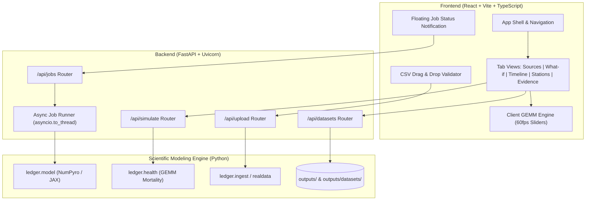

# Full-Stack React & FastAPI Dashboard Design Specification

- **Date**: 2026-10-18
- **Topic**: Full-Stack React & FastAPI Dashboard Revamp for Pollution Blame Ledger
- **Status**: Draft / Pending Final Review

---

## 1. Overview & Objectives

The **Pollution Blame Ledger** currently relies on a single-file, zero-dependency HTML dashboard generated by Python string interpolation (`outputs/dashboard.html` from `dashboard/template.html`). While lightweight, it lacks modern component modularity, cannot run on-demand inference directly from the browser, and bundles raw JavaScript into a single large file.

This design revamps the UI into a **Modern Editorial / Scientific Full-Stack Web Application**:
- **Backend**: A modern **FastAPI** REST API wrapping the existing Python scientific engine (`ledger/`), serving pre-computed datasets, running real-time intervention simulations, validating user-uploaded CSVs, and executing long-running MCMC jobs in background threads.
- **Frontend**: A **React + Vite + TypeScript** single-page application styled with **Tailwind CSS** and **Lucide Icons**, incorporating **Recharts** and custom SVG components for scientific visualizations (whisker credible intervals, identifiability correlation matrices, station scatter maps, and timeline crosshairs).

---

## 2. System Architecture



---

## 3. Directory Layout

```
Pollution-blame-ledger/
├── backend/
│   ├── app/
│   │   ├── __init__.py
│   │   ├── main.py                  # FastAPI initialization, CORS, routing
│   │   ├── config.py                # App configuration, directories, constants
│   │   ├── routers/
│   │   │   ├── __init__.py
│   │   │   ├── datasets.py          # GET /api/datasets, GET /api/datasets/{id}
│   │   │   ├── simulate.py          # POST /api/simulate/interventions
│   │   │   ├── upload.py            # POST /api/upload/validate
│   │   │   └── jobs.py              # POST /api/jobs/run, GET /api/jobs/{id}
│   │   ├── schemas/
│   │   │   ├── __init__.py
│   │   │   ├── dataset.py           # Pydantic schemas for datasets & components
│   │   │   ├── simulation.py        # Request & response for policy simulator
│   │   │   ├── upload.py            # Upload verification responses
│   │   │   └── job.py               # Job lifecycle schemas
│   │   └── services/
│   │       ├── __init__.py
│   │       ├── job_runner.py        # Background task worker for MCMC runs
│   │       └── csv_validator.py     # CPCB schema validation & statistics
│   ├── requirements.txt             # fastapi, uvicorn, pydantic, python-multipart, httpx
│   └── tests/
│       ├── test_datasets_api.py
│       ├── test_simulate_api.py
│       ├── test_upload_api.py
│       └── test_jobs_api.py
│
├── frontend/
│   ├── index.html
│   ├── package.json                 # react, react-dom, vite, typescript, tailwindcss, lucide-react, recharts
│   ├── tsconfig.json
│   ├── vite.config.ts
│   └── src/
│       ├── main.tsx
│       ├── App.tsx
│       ├── index.css
│       ├── api/
│       │   └── client.ts            # Typed API client fetching from FastAPI
│       ├── types/
│       │   └── index.ts             # TypeScript definitions matching backend schemas
│       ├── hooks/
│       │   ├── useDataset.ts        # Hook for dataset loading & caching
│       │   ├── useSimulation.ts     # Hook for client/server policy what-if
│       │   └── useJobPoller.ts      # Hook for background MCMC job tracking
│       ├── components/
│       │   ├── layout/
│       │   │   ├── Navbar.tsx
│       │   │   ├── Footer.tsx
│       │   │   └── DatasetHero.tsx
│       │   ├── common/
│       │   │   ├── Badge.tsx
│       │   │   ├── Card.tsx
│       │   │   ├── Drawer.tsx
│       │   │   └── Slider.tsx
│       │   ├── charts/
│       │   │   ├── StackedSourceBar.tsx
│       │   │   ├── HourlyTimelineChart.tsx
│       │   │   ├── CredibleIntervalWhisker.tsx
│       │   │   ├── IdentifiabilityHeatmap.tsx
│       │   │   └── StationScatterMap.tsx
│       │   ├── tabs/
│       │   │   ├── SourcesTab.tsx
│       │   │   ├── WhatIfTab.tsx
│       │   │   ├── TimelineTab.tsx
│       │   │   ├── StationsTab.tsx
│       │   │   └── EvidenceTab.tsx
│       │   └── upload/
│       │       ├── Dropzone.tsx
│       │       └── ColumnDiagnosticTable.tsx
│       └── utils/
│           ├── colors.ts            # Palette definitions for pollution sources
│           ├── formatters.ts        # Indian number formatting, rounding, CIs
│           └── gemm.ts              # Burnett et al. client-side health model
│
├── ledger/                          # Existing scientific modeling engine (unaltered)
├── data/                            # Raw data files
└── outputs/                         # Precomputed and newly generated JSON artifacts
```

---

## 4. API Specification & Schemas

### 4.1. Datasets
* `GET /api/datasets`
  * Response: `Array<DatasetSummary>`
    ```json
    [
      {
        "id": "demo",
        "name": "Synthetic demo (known truth)",
        "kind": "synthetic",
        "total_pm25_mean": 214.3,
        "stations_count": 6,
        "dominant_source": "biomass"
      }
    ]
    ```
* `GET /api/datasets/{dataset_id}`
  * Response: `DatasetDetail` containing:
    * `components`: array of 5 sources (`traffic`, `industry`, `dust`, `biomass`, `background`) with `share` ({mean, lo, hi}), `ugm3`, `deaths_100`, `status` (`identified`, `weak`, `unresolved`).
    * `total_pm25`: `{mean, lo, hi}`
    * `identifiability`: flagged collinear pairs with combined sum.
    * `stations`: per-station PM2.5 and source breakdown.
    * `literature`: reference study ranges (IIT Kanpur, CEEW).
    * `hourly`: time-series arrays for timeline charting.

### 4.2. Policy Simulation ("What-if")
* `POST /api/simulate/interventions`
  * Request Body:
    ```json
    {
      "dataset_id": "demo",
      "cuts": {
        "traffic": 30,
        "industry": 0,
        "dust": 50,
        "biomass": 20
      }
    }
    ```
  * Response:
    ```json
    {
      "original_pm25": 214.3,
      "new_pm25": 142.1,
      "absolute_reduction": 72.2,
      "percentage_reduction": 33.7,
      "who_exceedance_multiplier": 9.47,
      "averted_deaths_mean": 42.1,
      "averted_deaths_range": [28.4, 55.7],
      "averted_admissions_mean": 118.0
    }
    ```

### 4.3. CSV Upload Validation
* `POST /api/upload/validate`
  * Input: `multipart/form-data` with `file: UploadFile`.
  * Response:
    ```json
    {
      "valid": true,
      "row_count": 8760,
      "date_range": ["2018-06-01T00:00:00", "2019-05-31T23:00:00"],
      "columns_present": ["PM2.5", "PM10", "NO2", "SO2", "CO", "WS", "WD"],
      "columns_missing": [],
      "columns_optional": ["SR", "AT"],
      "missing_percentage_pm25": 2.4,
      "preview_points": [{"hour": 0, "pm25": 112.5}]
    }
    ```

### 4.4. Async Job Execution
* `POST /api/jobs/run`
  * Request Body: `{ "type": "synthetic" | "uploaded_file", "config": { ... } }`
  * Response: `{ "job_id": "job_20261018_123456", "status": "queued" }`
* `GET /api/jobs/{job_id}`
  * Response:
    ```json
    {
      "job_id": "job_20261018_123456",
      "status": "running",
      "progress_percent": 45,
      "current_stage": "Running NumPyro NUTS MCMC (chain 1/1)...",
      "started_at": "2026-10-18T20:50:00Z",
      "result_dataset_id": null,
      "error": null
    }
    ```

---

## 5. Frontend Visual Hierarchy & Component Details

### 5.1. Color Theme & Consistency
* Primary Background: `#f8fafc` / `#0f172a` (Light & Dark theme aware).
* Source Color Mapping (preserved from scientific literature):
  * **Vehicles (`traffic`)**: Blue (`#2563eb`)
  * **Factories (`industry`)**: Purple (`#8b5cf6`)
  * **Road & Construction Dust (`dust`)**: Amber (`#f59e0b`)
  * **Crop Residue Burning (`biomass`)**: Red (`#ef4444`)
  * **Regional Haze (`background`)**: Slate Gray (`#94a3b8`)

### 5.2. Executive Summary Hero
* Top KPI Cards:
  * **Mean Smog Level**: Large bold PM2.5 value with WHO 24-hr guideline ratio badge.
  * **Top Smog Contributor**: Icon, source name, and % share with 90% credible interval.
  * **Episode Attributable Burden**: Equivalent adult health impact according to GEMM curve.
* Interactive **Stacked Distribution Bar**:
  * Shows full 100% split with tooltip hover and direct drill-down click into the respective source drawer.

### 5.3. Five Focused Workspace Tabs
1. **Sources Tab**:
   * Grid of 5 responsive cards for each source.
   * Clicking a card opens a slide-over `SourceDetailDrawer` showing:
     * Specific chemical tracers used (e.g. CO & NO2 for traffic, SO2 for industry, coarse PM for dust, FIRMS + wind for biomass).
     * 90% credible intervals and widening factor.
     * Identifiability status badge (Green "Confident", Amber "Rough estimate", Red "Can't tell apart from partner").
2. **What-If? Policy Simulator Tab**:
   * Interactive sliders (0% to 100% in 5% increments) for each active controllable source.
   * Responsive instant comparison display: Before vs. After PM2.5 gauge, averted deaths counter, clean air days won.
3. **Timeline Tab**:
   * Recharts multi-line/area chart showing 24/48-hour or multi-day smog fluctuations.
   * Interactive hover crosshair and click-to-pin hour inspector revealing the exact source contribution at that timestamp.
4. **Monitoring Stations Tab**:
   * Delhi NCR coordinate scatter map.
   * Bubble size proportional to station-observed PM2.5, colored by top local source.
   * Station-by-station comparative breakdown list.
5. **Scientific Evidence & Proof Tab**:
   * Credible interval whisker plots (true vs. estimated).
   * Identifiability correlation matrix heatmap (visualizing collinearity).
   * Baseline performance table (Bayesian Ledger vs. NNLS vs. Fixed Split).
   * Literature comparison charts (IIT Kanpur 2015 study, CEEW 2019 inventory).

---

## 6. Error Handling, Edge Cases & Robustness

1. **Source Collinearity**:
   * When JAX posterior covariance indicates strong negative correlation (e.g. between biomass and traffic in specific wind regimes), individual shares are flagged as `unresolved`. The UI displays a warning banner and groups them into their combined sum.
2. **Missing CSV Columns or Negative Measurements**:
   * Pre-upload parsing warns users instantly if values are missing, negative, or physically impossible (e.g., PM2.5 > PM10).
3. **Long MCMC Sampling Times**:
   * Background runner prevents HTTP timeouts. Jobs persist progress in `outputs/jobs/`. If a user refreshes the browser, active jobs are recovered and continue polling.
4. **Offline / Network Resilience**:
   * The React app caches active dataset payloads in browser memory and `localStorage`, allowing smooth offline exploration of loaded datasets even if the backend is temporarily restarted.

---

## 7. Testing Strategy

1. **Backend Tests (`backend/tests/`)**:
   * Unit test for API endpoints using `httpx.AsyncClient`.
   * Parity test ensuring `/api/simulate/interventions` returns results matching `ledger.health.gemm_mortality`.
   * Validation test checking CSV parsing with real files in `data/cpcb/`.
2. **Frontend Tests**:
   * TypeScript type checking (`tsc --noEmit`).
   * Unit test for `src/utils/gemm.ts` ensuring client-side health calculation matches backend Python results within 0.1% tolerance.
   * Production build verification (`npm run build`).
3. **End-to-End Smoke Test**:
   * Start FastAPI and Vite dev servers.
   * Verify all 5 tabs render, sliders interact smoothly, dataset switches correctly, and upload validator functions properly.
